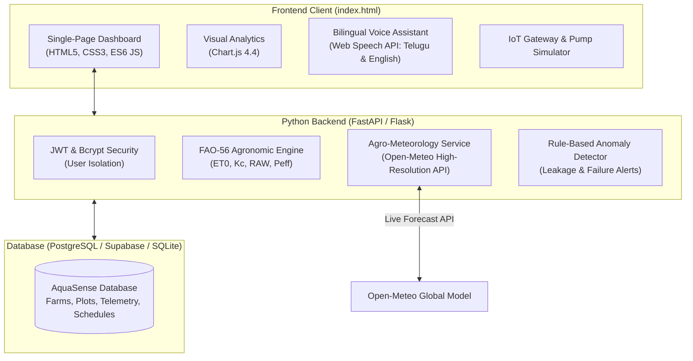

# 🌱 AquaSense AI — Smart Irrigation & Water Optimization System

AquaSense AI is an intelligent, full-stack, precision agricultural irrigation and water optimization platform. It assists farmers in determining **when to irrigate**, **how much water to apply**, **whether irrigation can be safely postponed due to incoming rainfall**, and **how to identify irrigation anomalies (leakages, pump trips, sensor stagnation)** before crops suffer moisture stress.

---

## 🏛️ System Architecture



---

## 🌾 Agronomic Recommendation Formulas (FAO-56 Standard)

AquaSense AI does not fabricate advice or mislabel statistical algorithms as black-box "AI". It implements transparent, defensible, peer-reviewed agronomic formulas:

### 1. Reference Evapotranspiration ($ET_0$)
Calculated using the Hargreaves-Samani thermodynamic approximation:
$$ET_0 = 0.0023 \cdot (T_{mean} + 17.8) \cdot \sqrt{T_{max} - T_{min}} \cdot R_a$$
Where:
- $T_{mean}$: Mean daily ambient temperature (°C)
- $R_a$: Extraterrestrial solar radiation proxy ($MJ/m^2/day$)

### 2. Crop Evapotranspiration ($ET_c$)
$$ET_c = K_c \cdot ET_0$$
Where $K_c$ is the crop coefficient specific to growth stage (Initial, Crop Development, Mid-Season, Late Season).

### 3. Total Available Water ($TAW$) & Readily Available Water ($RAW$)
$$TAW = AWC \cdot Z_r$$
$$RAW = p \cdot TAW$$
Where:
- $AWC$: Available Water Capacity of the soil ($mm/m$)
- $Z_r$: Effective root-zone depth ($m$)
- $p$: Soil water depletion fraction before crop moisture stress

### 4. Soil Water Depletion ($D$)
$$D = \frac{FC - SM}{FC - WP} \cdot TAW$$
Where $FC$ is Field Capacity (%), $WP$ is Permanent Wilting Point (%), and $SM$ is Current Soil Moisture (%).

### 5. Effective Rainfall Accounting ($P_{eff}$)
$$P_{eff} = \max(0, (P_{forecast} - 3.0) \cdot 0.8) \cdot \left(\frac{P_{prob}}{100}\right)$$
If $P_{eff}$ covers $\ge 50\%$ of root depletion, the system advises **"Delay & Recheck"**, avoiding double-watering, water wastage, and fertilizer leaching.

### 6. Gross Irrigation Requirement ($GIR$) & Volume ($V$)
$$NIR = \max(0, D - P_{eff})$$
$$GIR = \frac{NIR}{\eta_{irrigation}}$$
$$V_{Litres} = GIR \cdot Area_{m^2}$$
Where $\eta_{irrigation}$ is application efficiency (Drip: 90%, Sprinkler: 75%, Flood: 50%).

---

## ⚡ Quick Start Guide

### Option 1: Standalone Browser Launch (Zero Installation)
Simply double-click or open `index.html` in any modern web browser:
```bash
# Directly open the main application in your browser
start "" "c:\Users\GANESH\OneDrive\Desktop\AQUASENSE AI\index.html"
```
The application loads immediately with pre-configured high-resolution demonstration farms, interactive charts, and local state persistence!

### Option 2: Full-Stack Launch with Python Backend
```bash
# 1. Navigate to the project directory
cd "c:\Users\GANESH\OneDrive\Desktop\AQUASENSE AI"

# 2. Install dependencies
pip install -r requirements.txt

# 3. Seed demo agricultural telemetry data
python backend/seed_data.py

# 4. Start the AquaSense AI server
python backend/run.py
```
Visit `http://127.0.0.1:5000` to access the full-stack system.

---

## 🧪 Running Automated Tests

AquaSense AI comes with an automated unit test suite covering agronomic calculations, rainfall postponement, anomaly detection, and authentication:

```bash
python -m pytest backend/tests -v
```

All 11 unit tests validate:
- ✅ FAO-56 Reference Evapotranspiration ($ET_0$) calculation
- ✅ Plot area conversion (Acres, Hectares, Gunthas to $m^2$)
- ✅ "Irrigate Now" trigger when moisture drops below threshold
- ✅ "Monitor" trigger when moisture is optimal
- ✅ "Delay and Recheck" trigger when heavy rain is forecast
- ✅ Critical low moisture anomaly detection
- ✅ Excess moisture saturation detection
- ✅ Frozen/stuck sensor stagnation detection
- ✅ Rain forecast schedule conflict detection
- ✅ Password hashing (bcrypt) and verification
- ✅ JWT token generation and authentication

---

## 📂 Project Structure

```
AQUASENSE AI/
├── index.html                     # Main application entry point
├── css/
│   └── style.css                  # Forest green & mint agricultural design system
├── js/
│   ├── translations.js            # Bilingual English & Telugu dictionary
│   ├── recommendation_engine.js   # Client-side FAO-56 agronomic engine
│   ├── api.js                     # Dual-mode API client with offline persistence
│   └── app.js                     # Master UI orchestrator & Chart.js controllers
├── backend/
│   ├── app/
│   │   ├── __init__.py            # Flask app factory & static file proxy
│   │   ├── config.py              # Configuration loader
│   │   ├── database.py            # PostgreSQL / SQLite connection layer
│   │   ├── models.py              # SQLAlchemy database models
│   │   ├── auth.py                # JWT and bcrypt security
│   │   ├── recommendation_engine.py # FAO-56 calculation engine
│   │   ├── weather_service.py     # Live Open-Meteo weather integration
│   │   ├── anomaly_detector.py    # Rule-based failure detection
│   │   └── routes/                # REST API endpoints
│   ├── tests/                     # Pytest automated test suite
│   ├── seed_data.py               # Realistic agricultural demo data seeder
│   └── run.py                     # Backend server entrypoint
├── database/
│   ├── schema.sql                 # DDL schema for PostgreSQL / SQLite
│   └── supabase_setup.sql         # Supabase Row Level Security (RLS) policies
├── requirements.txt               # Python package dependencies
├── .env.example                   # Environment variable template
├── .env                           # Local environment configuration
└── README.md                      # Comprehensive technical documentation
```

---

## 🌐 Telugu Voice Assistant Interaction Examples

AquaSense AI includes a voice assistant interface supporting speech recognition and text-to-speech in both **Telugu** and **English**:

| Telugu Farmer Question | English Meaning | System Agronomic Response Basis |
|---|---|---|
| *"Naa polaniki eeroju neeru pettala?"* | Should I irrigate my plot today? | Compares current soil moisture with critical depletion threshold and rain forecast. |
| *"Varsham pade avakasam unda?"* | Is there a chance of rain? | Reads live 48h meteorological rainfall probability and volume. |
| *"Entha neeru avasaram?"* | How much water is needed? | Computes exact gross irrigation requirement in Litres and pump minutes. |
| *"Naa soil moisture entha undi?"* | What is my soil moisture level? | Displays current telemetry percentage and target buffer zone. |

---

## 🔒 Security & Data Privacy
- **Password Protection**: Salted bcrypt hashing with 12 rounds. Plaintext passwords are never stored.
- **JWT Authorization**: Cryptographically signed bearer tokens with configurable expiration.
- **Multi-Tenant User Isolation**: Database queries strictly filter records by `user_id`. Supabase Row Level Security (RLS) policies enforce database-level isolation.
- **Emergency Hardware Stop**: Remote pump controls require explicit user confirmation and include an instantaneous emergency stop mechanism.
